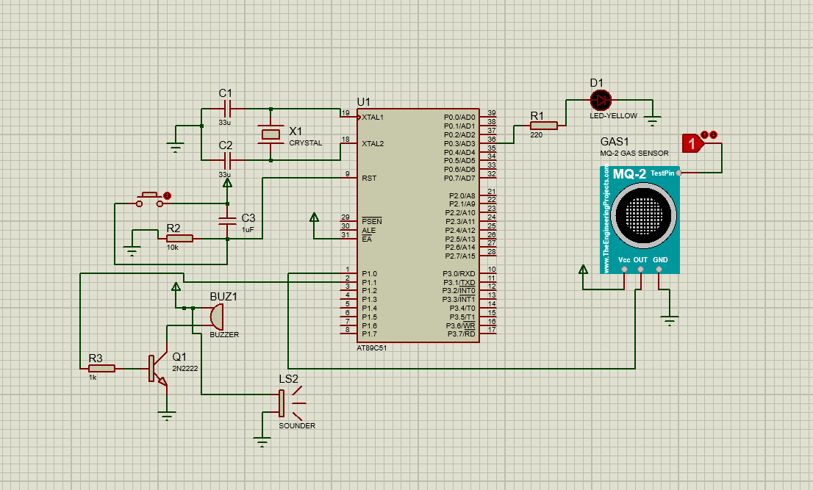
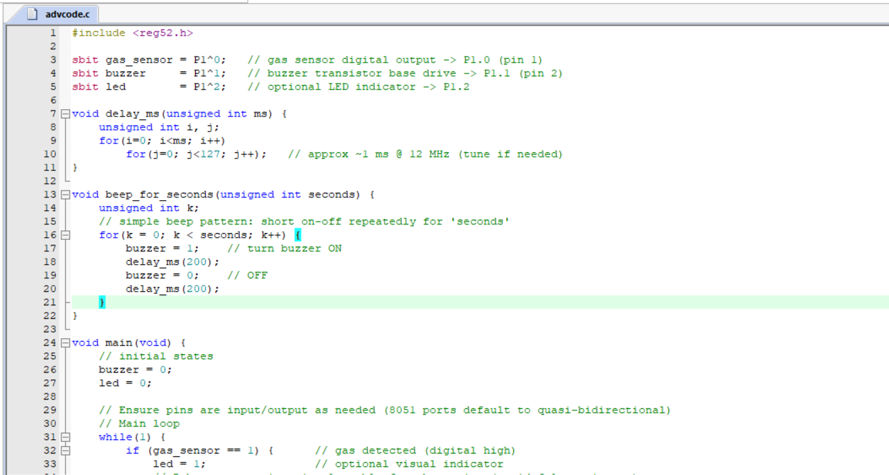
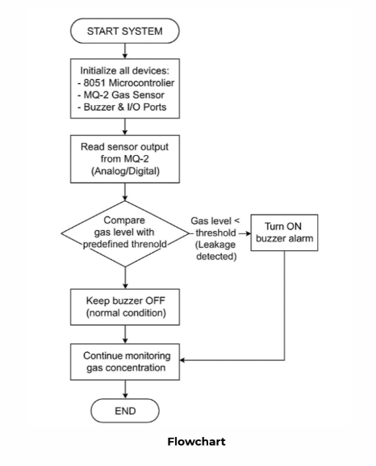

# Gas Leakage Detection System Using 8051 Microcontroller

<p align="center">
  <strong>Embedded Systems | Microcontroller Programming | Sensor Interfacing | Circuit Simulation</strong>
</p>

A microcontroller-based gas leakage detection system designed to monitor gas sensor output and activate audible and visual alerts when a potential gas leakage condition is detected.

---

## Project Overview

Gas leakage can create serious safety risks in residential, laboratory, and industrial environments. An electronic monitoring system can help identify elevated gas levels and provide an immediate warning.

This project uses an **AT89C51 (8051-family) microcontroller** interfaced with an MQ-2 gas sensor, an LED indicator, and a buzzer alarm circuit. The microcontroller monitors the sensor output and controls the warning indicators according to the programmed detection logic.

The circuit and program illustrate fundamental embedded systems concepts, including digital input monitoring, GPIO control, transistor-based switching, and embedded C programming.

## Objectives

- Interface an MQ-2 gas sensor with an 8051-family microcontroller.
- Monitor the sensor's digital output.
- Activate a buzzer when the programmed gas-detection condition is met.
- Provide a visual indication using an LED.
- Implement the monitoring logic using embedded C.
- Design and simulate the circuit before hardware implementation.

## Hardware Components

| Component | Purpose |
|---|---|
| AT89C51 microcontroller | Reads the sensor signal and controls the outputs |
| MQ-2 gas sensor module | Detects combustible gases and smoke-related changes |
| Buzzer | Provides an audible warning |
| Yellow LED | Provides a visual status indication |
| 2N2222 NPN transistor | Switches the buzzer load |
| Base resistor | Limits transistor base current |
| Crystal oscillator | Provides the microcontroller clock |
| Capacitors | Support clock and reset circuitry |
| Pull-up/reset components | Support the microcontroller reset circuit |
| Power supply | Supplies the circuit with the required operating voltages |

Component values and connections should be verified against the final circuit schematic.

## Circuit Schematic



The schematic shows the AT89C51 controller, MQ-2 sensor module, crystal oscillator, reset network, LED indicator, transistor-driven buzzer, and associated components.

### Circuit Operation

1. The MQ-2 module provides a digital output corresponding to its configured detection threshold.
2. The microcontroller reads the sensor signal through an input pin.
3. The embedded program evaluates the input state.
4. When the programmed detection condition is met, the microcontroller activates the alarm output.
5. The transistor switches the buzzer, while the LED provides a visual indication.
6. The system continues monitoring the sensor input.

## Software and Programming

- **Programming language:** Embedded C
- **Microcontroller family:** 8051
- **Header file:** `reg52.h`
- **Development workflow:** Compile the source code for the target microcontroller and load the resulting firmware using a compatible programmer.

The source code screenshot shows the following pin assignments:

| Signal | Port pin | Function |
|---|---|---|
| Gas sensor | P1.0 | Digital sensor input |
| Buzzer control | P1.1 | Alarm output |
| LED indicator | P1.2 | Visual alert output |

The displayed circuit schematic and source-code screenshot should be checked together before hardware testing to confirm that the signal connections match the firmware.

## Embedded C Source Code



The displayed program uses the `reg52.h` header and declares the sensor, buzzer, and LED signals as 8051 port bits. It also defines a software delay routine and a repeating buzzer pattern.

The main program initializes the alarm outputs and continuously evaluates the sensor input.

The screenshot shows a digital-input monitoring approach. It does not establish that an analog gas concentration value is measured or displayed.

## System Flowchart



### Algorithm

1. Start the system.
2. Initialize the microcontroller, sensor interface, buzzer, and I/O ports.
3. Read the MQ-2 module output.
4. Compare the sensor state against the configured detection threshold.
5. If the gas-detection condition is met, activate the buzzer alarm.
6. Otherwise, keep the alarm off.
7. Continue monitoring the sensor output.

**Note:** The actual threshold depends on the MQ-2 module's hardware adjustment and output configuration. The digital interface does not directly provide a calibrated gas concentration in ppm.

## Working Principle

The MQ-2 sensor module responds to combustible gases and smoke-related conditions. Its onboard circuitry can provide a digital signal when the sensor reading crosses a configured threshold.

The AT89C51 continuously reads this signal. Depending on the input state, the firmware controls the LED and buzzer outputs. A 2N2222 transistor is used as a switching stage for the buzzer circuit.

The system demonstrates a basic embedded monitoring and alert mechanism.

## Key Features

- Continuous digital sensor monitoring.
- Microcontroller-controlled audible alarm.
- LED-based visual indication.
- Transistor-based buzzer switching.
- Embedded C implementation.
- Modular circuit suitable for learning and experimentation.

## Applications

Potential educational and prototype applications include:

- Gas leakage alert demonstrations.
- Embedded systems laboratory experiments.
- Sensor interfacing practice.
- Microcontroller-based safety alarm prototypes.
- Digital input and output control demonstrations.

## Limitations

- The shown firmware uses a digital sensor output rather than calibrated concentration measurement.
- Detection depends on sensor warm-up, calibration, module adjustment, and environmental conditions.
- No measured detection range or accuracy is established by the provided screenshots.
- The circuit is an educational prototype and is not a certified gas safety system.

## Future Improvements

- Add an LCD or display to show system status.
- Log sensor events with timestamps.
- Add wireless notifications using a suitable communication module.
- Evaluate sensor response under controlled test conditions.
- Implement a calibrated analog measurement path if concentration estimation is required.
- Improve fault detection for sensor disconnection and power failure.

## Repository Structure

```text
GasLeakageSystem/
├── README.md
├── src/
│   └── advcode.c
├── images/
│   ├── circuit-schematic.png
│   ├── source-code.png
│   └── flowchart.png
└── simulation/
```

The folder structure represents the intended organization. Add the actual source code and simulation files as they become available.

## Author

**Atharva Jadhav**

Electronics and Telecommunication Engineering

- GitHub: [atharva-446](https://github.com/atharva-446)
- Portfolio: [atharvajadhav.co.in](https://atharvajadhav.co.in)

---

*This project is intended for educational purposes. It must not replace certified gas detection equipment or approved industrial safety systems.*
